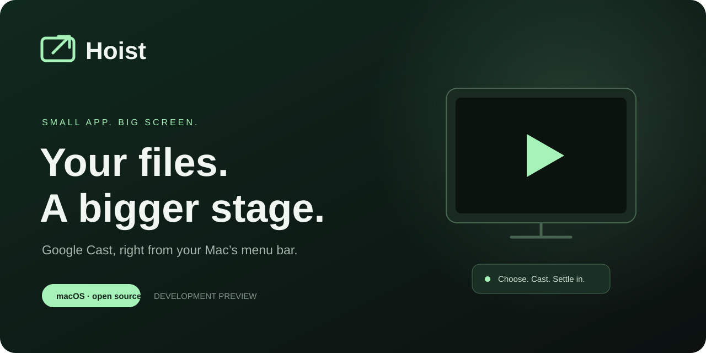
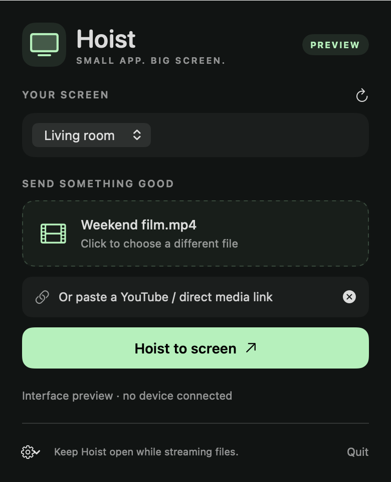

<p align="center"></p>

<p align="center">
  <a href="https://github.com/TheOneWhoBurns/hoist/releases">Download preview</a> ·
  <a href="#getting-started">Getting started</a> ·
  <a href="#compatibility">Compatibility</a> ·
  <a href="docs/ROADMAP.md">What’s next</a>
</p>

Hoist sends video and audio from your Mac to a Google Cast screen. Choose a file, pick your TV, and settle in. The controls live in your menu bar, and the casting helper comes bundled inside the app.

**Free. Open source. Built for the menu bar.**

> **Development preview:** the Apple Silicon build is ad-hoc signed, not Apple Developer ID signed or notarized. Downloaded builds may be blocked by Gatekeeper. This is not yet a frictionless public release. YouTube playback has been verified on a real Chromecast; the corrected local-file receiver routing still needs a hardware retest. [Validation details](docs/VALIDATION.md).

## A little app for a bigger screen

- **A home in the menu bar.** A compact popover, with no main window or Dock icon.
- **Bring your own media.** Choose a video or audio file, or drop it into the popover.
- **Pick your screen.** Nearby Google Cast devices appear automatically; Hoist remembers your selection.
- **Stay in control.** Pause, resume, stop, seek, and adjust volume from the same place.
- **Send a link.** Direct media URLs and an experimental YouTube integration are included.
- **One app to install.** The runtime and Cast helper are bundled. End users do not install Python, Homebrew, or a browser extension.

<p align="center"><br><sub>Actual app view rendered in preview mode. Device information is illustrative.</sub></p>

## Getting started

1. Download the Apple Silicon ZIP from [Releases](https://github.com/TheOneWhoBurns/hoist/releases), or build the app below.
2. Move **Hoist.app** to Applications and open it. The preview is not notarized; building locally is an alternative if macOS blocks the downloaded app. Do not disable Gatekeeper globally.
3. Allow Local Network access when macOS asks. Connect your Mac and Chromecast to the same local network.
4. Click Hoist’s menu bar icon, choose your screen, and select a file.
5. Click **Hoist to screen**. Keep the app and your Mac awake while streaming local files.

The first build targets **Apple Silicon and macOS 13+**. It has only been run on the development machine; older macOS versions are not yet verified. Intel builds need separate packaging and validation.

## Compatibility

| Source | Preview support |
| --- | --- |
| Local H.264/AAC MP4 and receiver-compatible audio | Implemented; transport checked, corrected receiver routing awaits hardware retest |
| Other local containers and codecs | Depends on your receiver; no transcoding yet |
| Direct HTTP(S) video/audio links | Implemented; receiver must be able to fetch and decode them |
| Unencrypted HLS / DASH links | Experimental; requires compatible receiver, codecs and server configuration |
| YouTube video links | Experimental; real-device playback verified |
| Arbitrary website page URLs | Not supported |
| Native Cast buttons in Firefox | Planned companion extension |
| Twitch, Prime Video, Netflix, F1 TV integrations | Not implemented or claimed compatible |
| AirPlay, DLNA, screen mirroring | Not implemented |

Streaming services have their own receiver apps, authentication and DRM requirements. A browser companion cannot guarantee compatibility with every service simply by exposing a Cast button. Ads in a receiver app are also outside a browser extension’s filtering scope.

## Built to stay local

Hoist has no accounts, analytics, advertising, or cloud relay. Its Swift interface talks to the bundled helper through private process pipes, without a control server listening on your network.

For a local file, Hoist temporarily serves only that selected file on the network interface used to reach your Chromecast, at a randomly generated URL. It supports byte ranges for seeking. The endpoint is closed when you stop playback, replace the media, or quit. This is local HTTP: the random URL is a capability, not encrypted transport, so use a trusted network. Hoist does not share folders or enumerate your files.

Online media is fetched by the receiver and, for YouTube session control, by the helper. Those requests still go to the relevant service. Device selection is saved locally; pasted URLs and selected file paths are not persisted by Hoist.

## Build it yourself

Build requirements: Apple Silicon Mac, Xcode Command Line Tools, and [uv](https://docs.astral.sh/uv/). The script installs a pinned Python build environment and bundles the runtime; these are development requirements only.

```sh
git clone https://github.com/TheOneWhoBurns/hoist.git
cd hoist
bash scripts/build.sh
open dist/Hoist.app
```

The output is `dist/Hoist.app`, an architecture-specific ZIP, and its SHA-256 checksum. Builds are ad-hoc signed. Developer ID signing and notarization are a release milestone, not something this script claims to do.

Run the process-and-network system checks:

```sh
.venv/bin/python tests/system_check.py dist/Hoist.app/Contents/Resources/service/hoist-service
dist/Hoist.app/Contents/MacOS/Hoist --diagnose
```

These checks do not send playback commands to your TV. Real-receiver verification is documented separately.

## Under the hood

SwiftUI and AppKit provide the native popover. [PyChromecast](https://github.com/home-assistant-libs/pychromecast) handles discovery and receiver communication; [casttube](https://github.com/ur1katz/casttube) provides YouTube session control. PyInstaller bundles the helper and Python runtime into the app. Build dependencies are pinned in `requirements-build.txt`; third-party notices ship in the app’s Resources/Licenses directory.

The next step is a Firefox companion that uses this same app. Follow the [roadmap](docs/ROADMAP.md) for its scope and compatibility gates.

MIT license for Hoist’s code. Dependencies retain their own licenses. Hoist is an independent project and is not affiliated with Google or any streaming service.
